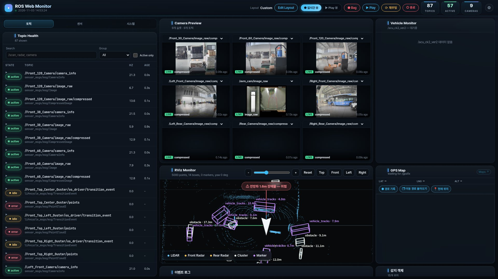

# ROS Web Monitor

ROS 2 차량의 센서, 인식 결과, 시스템 상태를 브라우저 한 화면에서 보는 경량 웹 대시보드입니다.
ROS 2 노드 하나(`monitor_node`)가 모든 토픽을 구독하고, 내장 HTTP 서버로 대시보드를 제공합니다.
별도 웹 서버나 Node.js는 필요 없습니다.



## 주요 기능

| 패널 | 내용 |
|---|---|
| **Topic Health** | 전체 토픽의 상태(active / idle / error), 주기(Hz), 마지막 수신 후 경과 시간. 검색, 그룹 필터, 행을 펼쳐 최근 메시지 값 확인 |
| **센서 그룹** | Cameras · LiDAR · Radar · Localization · Vehicle/CAN · Perception별 활성 토픽 수 요약 |
| **시스템 (Jetson)** | jtop 기반 CPU 코어별 사용률, GPU, 메모리, 온도, HW 엔진, 전원 모드 |
| **Camera Preview** | `Image` / `CompressedImage` 토픽을 MJPEG로 미리보기. 슬롯 추가, 삭제, 순서 변경, 열 수 조절. 상태 배지: `LIVE` / `WAIT` / `NO SIGNAL`(3초 이상 프레임 없음) |
| **RViz Monitor** | PointCloud2, MarkerArray, 레이더, 클러스터, 트랙을 브라우저에서 3D로 표시. Top/Front/Left/Right 시점, 레이어 토글, 근접 장애물 경고 배너 |
| **GPS Map** | `NavSatFix` / `GPSFix` 위치를 Leaflet 지도에 표시. 이동 경로 기록, 저장, 불러오기 |
| **Vehicle Monitor** | `/acu_ck2_ver2` 기반 기어, 조향, 페달, 바퀴 속도, 배터리, 모터 토크 게이지 |
| **감지 객체 / 이벤트 로그** | 인식된 객체 목록(유형, 방위, 거리, 크기)과 상태 변화 이벤트 |
| **Bag 녹화 / 재생** | 전체 또는 선택 토픽 녹화(`ros2 bag record`). ROS 1 `.bag`, ROS 2 bag 재생. 재생 토픽은 `/bagplay/...`로 분리되며 **Play 뷰**에서 확인 |
| **전원** | 상단 버튼으로 보드 재부팅 / 종료 (sudoers 설정 필요, 아래 참고) |

화면 배치는 **Edit Layout**에서 패널을 드래그하고 크기를 바꿔 조정합니다. 상단 ⚙에서 헤더 항목, Bag 녹화, RViz 레이어, 백업을 설정합니다.

## 요구 사항

- ROS 2 Jazzy (Ubuntu 24.04, Jetson AGX Thor에서 검증)
- Python 패키지: `rclpy`, `sensor_msgs`, `sensor_msgs_py`, `rosidl_runtime_py`, `python3-opencv`, `python3-numpy`, `python3-pil`, `python3-yaml`
- 선택:
  - [jetson-stats](https://github.com/rbonghi/jetson_stats) (`jtop`): 시스템 탭 데이터용
  - `rosbags`: ROS 1 `.bag` 재생용. 처음 쓸 때 `~/.local/share/ros_web_monitor/rosbags_venv`에 자동 설치됩니다.
- 브라우저에서 CDN에 접속할 수 있어야 합니다(Leaflet 지도, 웹 폰트). 오프라인이면 지도가 표시되지 않고, 글꼴은 시스템 기본 폰트로 대체됩니다.

## 빌드 및 실행

```bash
cd ~/captin5_ws
colcon build --packages-select ros_web_monitor
source install/setup.bash

ros2 launch ros_web_monitor monitor.launch.py
# 또는 전체 시스템과 함께: ros2 launch bringup run.launch.xml
```

브라우저에서 `http://<host>:8080`에 접속합니다. 기본값은 `http://192.168.1.100:8080`입니다.

launch 인자 예시:

```bash
ros2 launch ros_web_monitor monitor.launch.py host:=0.0.0.0 port:=8080
```

## 파라미터

| 이름 | 기본값 | 설명 |
|---|---|---|
| `host` | `0.0.0.0` (launch: `192.168.1.100`) | HTTP 서버 바인드 주소 |
| `port` | `8080` | 대시보드, API 포트 |
| `stream_port` | `8081` | 카메라 MJPEG 스트림 전용 포트. 메인 포트의 브라우저 동시 연결 한도를 보호하기 위해 분리 |
| `scan_period_sec` | `2.0` | 토픽 목록 갱신 주기 |
| `rate_window_sec` | `5.0` | Hz 계산 구간 |
| `subscribe_all` | `true` | 모든 토픽 자동 구독 |
| `visual_max_points_per_topic` | `900` | RViz 패널에 보내는 토픽당 최대 포인트 수 (화면에서도 변경 가능) |
| `prune_after_sec` | `10.0` | 사라진 토픽을 목록에서 정리하기까지의 시간 |
| `bag_dir` | `/home/nvidia/robot_ws/bag` | Bag 녹화, 재생 기본 폴더 (화면에서 변경 가능) |

## 화면 설정 저장과 기본 설정 파일

레이아웃, 카메라 슬롯, RViz 레이어 같은 화면 설정은 **브라우저 localStorage**에 저장됩니다.
따라서 다른 브라우저나 다른 주소(`localhost` ↔ IP)로 접속하거나 브라우저 데이터를 지우면 설정이 비어 있습니다.

이를 보완하기 위해 저장소의 [`UI/`](UI/) 폴더에 기본 설정 파일을 둡니다.

- 브라우저에 저장된 설정이 없으면 페이지를 열 때 `UI/*.json` 중 **가장 최신 파일**(파일명 순)을 자동으로 적용합니다.
- ⚙ 설정 → **백업** 탭
  - **⬇ 설정 백업 다운로드**: 현재 설정을 JSON으로 저장
  - **⬆ 백업 불러오기**: JSON 파일로 복원
  - **📄 UI 폴더 설정 파일 불러오기**: `UI/`의 최신 파일로 강제 교체

팀 공통 기본 화면을 바꾸려면 다음 순서로 진행합니다.

1. 백업 탭에서 설정을 다운로드합니다.
2. 받은 파일을 `UI/`에 넣습니다.
3. 다시 빌드합니다(`colcon build --packages-select ros_web_monitor`).

## 재부팅 / 종료 버튼 설정

상단 **⟳ 재부팅**, **⏻ 종료** 버튼은 `sudo -n`으로 실행됩니다. 처음 한 번 비밀번호 없는 sudo를 허용해야 합니다.

```bash
echo "$USER ALL=(root) NOPASSWD: /usr/sbin/shutdown, /usr/sbin/reboot" \
  | sudo tee /etc/sudoers.d/ros_web_monitor_power && sudo chmod 440 /etc/sudoers.d/ros_web_monitor_power
```

## HTTP API

| 메서드 | 경로 | 설명 |
|---|---|---|
| GET | `/`, `/app.js`, `/app.css` | 대시보드 |
| GET | `/api/state` | 전체 상태 스냅샷 (토픽, 카메라, 시스템, GPS, 차량 등) |
| GET | `/events` | 상태 실시간 푸시 (Server-Sent Events) |
| GET | `/stream?topic=<topic>` | 카메라 MJPEG 스트림 (`stream_port`에서도 제공) |
| GET | `/api/ui/default-settings` | `UI/` 폴더의 최신 화면 설정 JSON |
| GET | `/api/bag/play/list` | 재생 가능한 bag 목록 |
| GET | `/api/gps/track/list`, `/api/gps/track/load?file=` | 저장된 GPS 이동 경로 |
| GET | `/api/fs/list?path=` | Bag 저장 폴더 탐색 |
| POST | `/api/viz-config` | RViz 패널 설정 반영 |
| POST | `/api/bag/config`, `/api/bag/start`, `/api/bag/stop` | Bag 녹화 |
| POST | `/api/bag/play/{start,stop,pause,resume,next,seek,rate}` | Bag 재생 제어 |
| POST | `/api/gps/track/{start,stop,delete}` | GPS 이동 경로 기록 |
| POST | `/api/fs/mkdir` | Bag 저장 폴더 생성 |
| POST | `/api/system/reboot`, `/api/system/shutdown` | 보드 전원 제어 |

## 디렉터리 구조

```
ros_web_monitor/
├── ros_web_monitor/
│   ├── monitor_node.py      # ROS 2 노드 + HTTP 서버 + API
│   └── web/                 # 프런트엔드 (index.html, app.js, app.css)
├── launch/monitor.launch.py
├── UI/                      # 기본 화면 설정 JSON (자동 적용)
├── docs/screenshot.jpg
├── log/gps/                 # GPS 이동 경로 저장 (git 제외)
├── package.xml
└── setup.py
```

## 문제 해결

- **페이지가 뜨지 않음**: `host` 파라미터의 주소로 접속했는지 확인하세요. launch 기본값은 `192.168.1.100`이라 `localhost`로는 접속할 수 없습니다.
- **화면 설정이 초기화됨**: 접속 주소나 브라우저가 바뀌었기 때문입니다. `UI/` 기본 설정이 자동 적용되며, 필요하면 백업 탭에서 다시 불러오세요.
- **시스템 탭이 비어 있음**: `jtop`이 설치되어 있고 `jtop.service`가 실행 중인지 확인하세요.
- **재부팅 / 종료 버튼 실패**: 위 sudoers 설정을 확인하세요.
