# ROS Web Monitor

ROS 2 차량의 센서, 인식 결과, 시스템 상태를 브라우저 한 화면에서 보는 경량 웹 대시보드입니다.
ROS 2 노드 하나(`monitor_node`)가 모든 토픽을 구독하고, 내장 HTTP 서버로 대시보드를 제공합니다.
별도 웹 서버나 Node.js는 필요 없습니다.

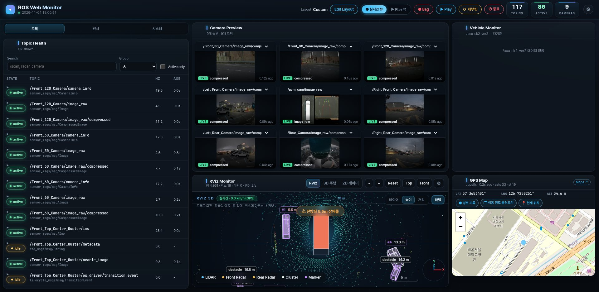

*실차 화면 (2026-11-04 18:00): 토픽 117개(활성 86), 카메라 9개 슬롯 모두 표시(스트림 포트 3개로 분산), RViz 탭(높이 색상 LiDAR·거리 링·차량 모양 자차·근접 경고), GNSS 위치(위성 33개)*

## 최근 업데이트 (2026-11-11)

| 분류 | 내용 | 설명 |
|---|---|---|
| 레이더 | CAN 매핑 수정: **전방 레이더 can5, 후방 레이더 can4** (기존 can6/can7 은 수신 0) | `can_parser` |
| 레이더 | RViz 탭, 3D 주행, 2D 레이더, 대시보드 3D 주행에 **레이더 점** 표시. `RadarMsg` 원값을 차체 기준으로 바꿔 그림 | [레이더](#레이더-전방-can5--후방-can4) |
| 차량 위치 | ⚙ → RViz → 차량 위치에 **전방/후방 레이더 위치** 입력 추가 | [레이더](#레이더-전방-can5--후방-can4) |
| 인지 카메라 | 객체 라벨에 **거리 `~XXm`** 표시. Front_120 은 Depth Anything 3 미터 깊이, 나머지는 크기 기반 | [인지 카메라 탭](#인지-카메라-탭) |
| 설정 백업 | 백업을 보드의 `UI/` 폴더에 저장·불러오기, 서버 저장 값(보정값·차선 범위·Bag 경로 등) 포함 | [화면 설정 저장](#화면-설정-저장과-기본-설정-파일) |

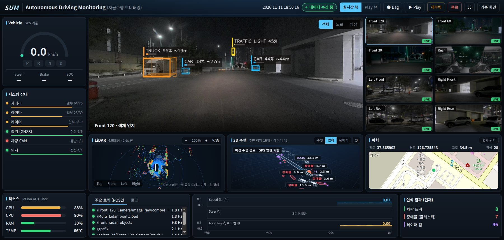

*대시보드 (2026-11-11 18:50): Front 120 객체 인지에 거리 라벨(TRUCK ~19m, CAR ~27m), 3D 주행에 레이더 점 46개(보라색), 인식 결과에 레이더 점 개수, 주요 토픽에 `/front_radar_objects` 9.8 Hz*

## 이전 업데이트 (2026-11-09)

| 분류 | 내용 | 설명 |
|---|---|---|
| 대시보드 | 한 화면에 모은 별도 페이지 `/cockpit` 추가. 기존 화면은 그대로 유지 | [대시보드](#대시보드-cockpit) |
| 대시보드 | **실시간 / Play 뷰**, **Bag 녹화**, **Bag 재생**, **재부팅 / 종료** | [상단 버튼](#상단-버튼) |
| 대시보드 | LiDAR 마우스 조작, 3D 주행 뷰, 지도 **현재 위치** 버튼 | [패널 구성](#패널-구성) |
| 장애물 표시 | 풀 등 클러스터 장애물을 3D 박스 대신 바닥 **다각형**으로 표시 | [장애물 다각형 표시](#장애물-다각형-표시) |
| 도로 인지 | YOLO 입력 값이 1.0을 미세하게 넘어 255로 한 번 더 나뉘던 문제 수정(`Dividing input by 255` 경고 제거) | `road_perception` |

## 이전 업데이트 (2026-11-06)

| 분류 | 내용 | 설명 |
|---|---|---|
| 카메라 화면 | **카메라 / 인지 카메라 / 도로 인지** 탭 분리 | [Camera Preview 탭](#camera-preview-탭) |
| 성능 | 카메라 미리보기 축소 변환, 불필요한 raw 영상 구독 제거 | [성능 관련 동작](#성능-관련-동작) |
| 왼쪽 패널 | **토픽 / 센서 / 시스템** 탭 디자인 변경 | [왼쪽 패널](#왼쪽-패널-토픽--센서--시스템) |
| 도로 인지 | `road_perception` 패키지의 결과 표시, 차선 인식 범위 편집 | [차선 인식 범위 설정](#차선-인식-범위-설정) |
| 카메라 보정 | 체커보드 촬영, 보정 전/후 비교, 보정값 폴더, `camera_info` 적용, 탭별 보정 적용 | [카메라 보정](#카메라-보정) |

**카메라 보정 현황**

| 카메라 | 보정값 | 비고 |
|---|---|---|
| Front_120 | 직접 보정, 검증 오차 0.43 px | 어안 모델, 샘플 25장 |
| Front_60 | 직접 보정, 검증 오차 0.28 px | 어안 모델, 샘플 25장 |
| Rear, Left/Right Front, Left/Right Rear | Front_120 값 복사 | 같은 120° 렌즈라는 전제. 카메라별 오차는 측정하지 않음 |
| Front_30 | 없음 | 체크박스가 켜져 있어도 원본으로 표시 |

## 주요 기능

| 패널 | 내용 |
|---|---|
| **Topic Health** | 전체 토픽의 상태(active / idle / error), 주기(Hz), 마지막 수신 후 경과 시간. 검색, 그룹 필터, 행을 펼쳐 최근 메시지 값 확인. [화면](#왼쪽-패널-토픽--센서--시스템) |
| **센서 그룹** | 카메라 · 라이다 · 레이더 · 측위 · 차량 CAN · 인지별 상태, 활성 토픽 수, 끊긴 토픽 요약 |
| **시스템 (Jetson)** | jtop 기반 CPU 코어별 사용률, GPU, 메모리, 온도, HW 엔진, 전원 모드 |
| **Camera Preview** | [**카메라 / 인지 카메라 / 도로 인지**](#camera-preview-탭) 탭. `Image` / `CompressedImage` 토픽 MJPEG 미리보기. 슬롯 추가·삭제·순서 변경·열 수 조절. 배지 `LIVE` / `WAIT` / `NO SIGNAL`. 클릭하면 [크게 보기](#카메라). 스트림 포트 여러 개로 나눠 연결해 6대를 넘어도 모두 표시 |
| **RViz Monitor** | 탭 3개: [**RViz**](#rviz-monitor-rviz-탭) / [**3D 주행** · **2D 레이더**](#주행-뷰-3d-주행--2d-레이더) |
| **GPS Map** | `NavSatFix` / `GPSFix` 위치를 Leaflet 지도에 표시. 이동 경로 기록·저장·불러오기. Bag 녹화와 함께 경로 기록, Play 시 bag 경로 표시([Bag](#bag-녹화--재생)) |
| **Vehicle Monitor** | `/acu_ck2_ver2` 기반 기어, 조향, 페달, 바퀴 속도, 배터리, 모터 토크 게이지 |
| **감지 객체** | 인식된 객체 목록(유형, 방위, 차체 기준 거리, 크기), 가까운 순. 차체 안의 박스(자차 클러스터)는 제외 |
| **이벤트 로그** | 모니터링 시작(활성 토픽 수), 시작 시 이미 오류인 센서·수신 없는 센서 그룹, 토픽 끊김 / 복구 / 오류, Bag 녹화 시작·종료, 고온(80°C), 배터리 부족(20%), 모니터 서버 연결 끊김·복구 |
| **Bag 녹화 / 재생** | 전체 또는 선택 토픽 녹화(기본: 대용량 토픽 제외). ROS 1 `.bag`, ROS 2 bag 재생. 재생 토픽은 `/bagplay/...`로 분리되어 **Play 뷰**에서 확인 |
| **차선 인식 범위** | ⚙ → **도로 인지**: 카메라별 차선 인식 범위를 영상 위에서 편집. [설명](#차선-인식-범위-설정) |
| **카메라 보정** | ⚙ → **카메라 보정**: 체커보드 렌즈 보정, 보정 전/후 비교, 보정값 관리, 탭별 적용. [설명](#카메라-보정) |
| **전원** | 상단 버튼으로 보드 재부팅 / 종료 (sudoers 설정 필요, 아래 참고) |
| **대시보드** | 차량·카메라·LiDAR·3D 주행·지도·상태를 스크롤 없이 한 화면에 모은 페이지. [설명](#대시보드-cockpit) |

화면 배치는 **Edit Layout**에서 패널을 드래그하고 크기를 바꿔 조정합니다. 상단 ⚙(또는 RViz 패널의 ⚙)에서 헤더 항목, Bag 녹화, RViz·차량 위치·주행 뷰, 도로 인지, 카메라 보정, 백업을 설정합니다.

## 대시보드 (/cockpit)

기존 화면 상단의 **대시보드** 링크를 누르거나 `http://<host>:8080/cockpit`으로 접속합니다. 기존 화면으로 돌아갈 때는 오른쪽 위 **기존 화면**을 누릅니다. 별도 페이지라서 기존 화면의 배치와 동작은 바뀌지 않습니다.

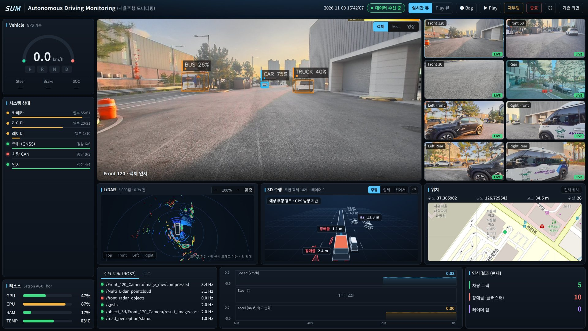

*실차 화면 (2026-11-09 16:42)*

### 패널 구성

| 패널 | 내용 |
|---|---|
| **Vehicle** | 속도 게이지, P/R/N/D, Steer, Brake, SOC. CAN이 없으면 GPS 속도를 씁니다 |
| **시스템 상태** | 카메라 · 라이다 · 레이더 · 측위 · 차량 CAN · 인지별 활성 토픽 수 |
| **리소스** | GPU, CPU, RAM, 온도 |
| **메인 카메라** | **객체 / 도로 / 영상** 전환. 인지 결과가 없으면 원본 영상으로 대체하고 라벨에 표시합니다 |
| **카메라 8대 썸네일** | 클릭하면 메인 카메라로 올라갑니다. 배지 `LIVE` / `PLAY` / `NO SIGNAL` |
| **LiDAR** | 높이 색상 점군. 드래그 회전, 휠 클릭 드래그 이동, 휠 확대, 더블클릭 초기화, Top / Front / Left / Right 시점, 확대율 표시와 **맞춤** |
| **3D 주행** | 기존 화면의 [3D 주행](#주행-뷰-3d-주행--2d-레이더) 코드를 그대로 사용합니다. 시점은 **주행 / 입체 / 위에서**. 카메라 타일은 대시보드에서만 끕니다 |
| **위치** | 위도, 경도, 고도, 위성 수와 지도. 지도를 끌면 따라가기가 멈추고 **현재 위치** 버튼이 강조되며, 누르면 최신 GPS 위치로 돌아와 다시 따라갑니다 |
| **주요 토픽 / 로그** | 핵심 토픽의 주기, 토픽 끊김·복구 기록(페이지를 연 뒤부터) |
| **그래프** | 최근 60초 Speed, Steer, Accel |
| **인식 결과** | 현재 차량 트랙, 클러스터 장애물, 레이더 점 개수 |

- 차량 치수와 Bag 녹화 대상은 같은 브라우저의 기존 화면 설정을 그대로 씁니다.
- 대시보드를 열면 RViz 점 수 상한이 5000으로 맞춰집니다. 서버 공용 설정이라 기존 화면에도 적용됩니다.

### 상단 버튼

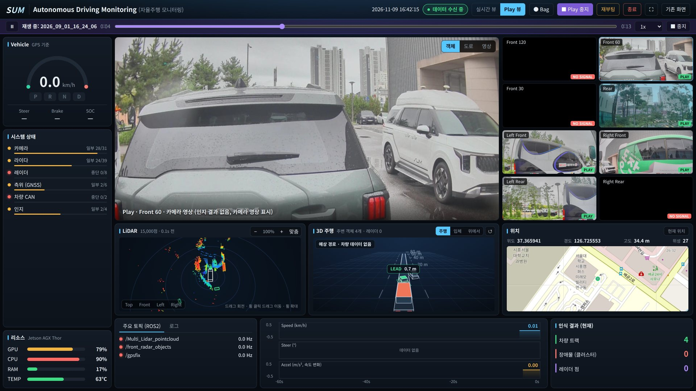

*Play 뷰: 헤더 아래 재생 바, `/bagplay` 데이터로 전환된 패널. 이 bag에는 Front 120 / Front 30 영상이 없어 `NO SIGNAL`로 표시됩니다*

| 버튼 | 동작 |
|---|---|
| **실시간 뷰 / Play 뷰** | 패널 전체의 데이터를 실시간 토픽과 `/bagplay/...` 토픽 사이에서 전환합니다 |
| **● Bag** | 녹화를 시작하고, 다시 누르면 저장합니다. 토픽 선택은 기존 화면의 ⚙ → **Bag 녹화** 설정을 따릅니다 |
| **▶ Play** | bag 목록을 띄웁니다. 선택하면 재생하면서 Play 뷰로 전환합니다. 반복 재생을 고를 수 있고, 재생 중에 누르면 중지합니다 |
| **재부팅 / 종료** | 확인 창을 거쳐 실행합니다. 녹화 중이면 bag을 먼저 저장합니다. [sudoers 설정](#재부팅--종료-버튼-설정) 필요 |

재생 중에는 헤더 아래에 컨트롤 바가 나타나 일시정지, 다음 프레임, 위치 이동, 배속(0.25~4x), 중지를 할 수 있습니다. 지도에는 재생 중인 bag의 전체 경로가 보라색으로 표시됩니다. bag에 해당 카메라 프레임이 없으면 메인 카메라 라벨에 `신호 없음`이 붙습니다.

## Camera Preview 탭

Camera Preview 패널은 탭 3개로 나뉩니다. 탭마다 슬롯 구성과 열 수를 따로 저장하고, 탭 옆 숫자는 `토픽이 있는 슬롯 / 전체 슬롯`입니다. 인지 카메라와 도로 인지 탭은 볼 때만 연결하고, 다른 탭으로 옮기면 연결을 닫아 부하를 줄입니다. 카메라 탭은 주행 뷰가 함께 쓰므로 항상 연결되어 있습니다.

| 탭 | 보여 주는 것 | 토픽 |
|---|---|---|
| **카메라** | 카메라 원본 영상 | `/<카메라>/image_raw/compressed` 등 |
| **인지 카메라** | 3D 객체 인지 결과 | `/object_3d/<카메라>/result_image/compressed` |
| **도로 인지** | 차선·노면표시·신호등·표지판 결과 | `/road_perception/<카메라>/result_image/compressed` |

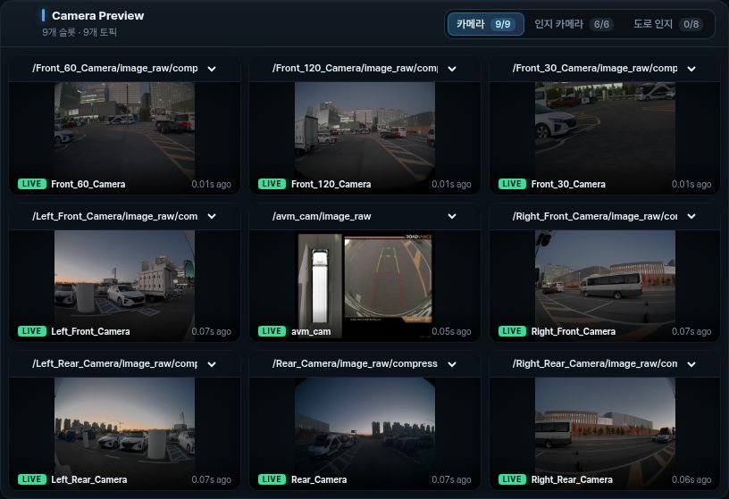

*카메라 탭: 렌즈 보정이 켜져 있어 왜곡을 편 영상이 표시됩니다. 스크린샷은 시험 환경에서 찍어 도로 인지 탭 숫자가 0/8입니다.*

### 인지 카메라 탭

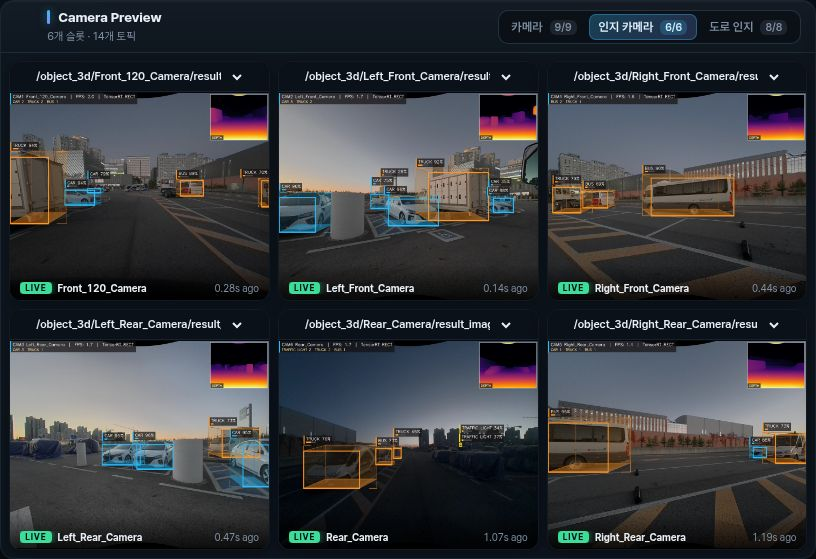

`object_3d` 결과를 960 px로 줄인 뒤 그려서 선과 글자가 선명합니다.

- **3D 박스**: 2D 검출 박스에서 원근감을 추정해 그린 입체 박스입니다. 실제 3D 측정값이 아닙니다.
- **라벨**: `종류 신뢰도 ~거리` 칩을 박스 위에 표시합니다. 차량·트럭처럼 겹치는 중복 박스는 하나로 줄입니다.
- **거리**: 카메라에서 객체까지의 거리(m)입니다. 사람·자전거·오토바이·승용차·버스·트럭만 표시하고, 카메라 렌즈 보정값이 있어야 나옵니다.
  - **Front_120**: Depth Anything 3(`DA3NESTED-GIANT-LARGE-1.1`) 미터 깊이. 별도 노드 `da3_depth_node`가 약 1 fps로 `/object_3d/Front_120_Camera/da3_depth`를 내고, 렌즈 초점거리로 스케일을 맞춥니다. HUD에 `DA3`가 붙고 오른쪽 위 깊이 영상이 미터 기준(0~40 m)으로 바뀝니다.
  - **나머지 카메라** 또는 DA3 깊이가 2.5초보다 오래됐을 때: 클래스 평균 높이 × 초점거리 ÷ 박스 높이(크기 기반). 화면 위·아래 끝에 잘린 박스는 거리를 내지 않습니다.
  - 근사값입니다(전방 120° 비교: 승용차 추정 20~21 m, LiDAR 22.4 m). 설정과 DA3 라이선스(CC BY-NC 4.0)는 `YOLO-3D/README.md` 참고.
- **HUD**: 위쪽에 카메라 이름, 처리 FPS, 추론 방식, 렌즈 보정 표시(`RECT`), 종류별 개수가 나오고, 오른쪽 위에 깊이 영상이 작게 나옵니다.
- **모델**: `YOLO-3D/config/config.yaml`의 `yolo_model`로 고릅니다. 현재 `yolo26x` TensorRT 엔진입니다.

### 도로 인지 탭

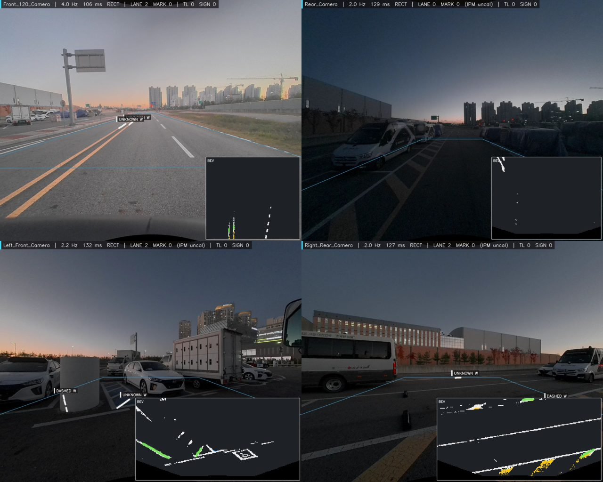

*결과 영상을 직접 받아 모은 그림입니다. 위 왼쪽 Front_120은 낮, 나머지는 저녁에 받았습니다. 대부분 차선 범위를 아직 맞추지 않은 상태라 HUD에 `IPM uncal`이 표시됩니다.*

- **차선**: 실선·점선·겹선과 색을 표시합니다. 내 차로 양쪽 선은 `EGO-L` / `EGO-R`로 강조합니다.
- **노면표시**: 화살표, 정지선, 횡단보도, 빗금 지대
- **신호등·표지판**: 신호 색과 표지판 종류. 표지판은 색·모양 기반이라 세부 종류는 구분하지 못합니다.
- **BEV (오른쪽 아래)**: 위에서 본 차선 후보입니다. 흰색·노란색은 페인트로 판정한 픽셀, 초록·하늘색 선은 인식한 차선입니다.
- **HUD**: 카메라 이름, 처리 주기, 처리 시간, `RECT`, 인식 개수, `IPM uncal`(범위가 근사값)

카메라별 역할과 주기는 `road_perception` 패키지의 `config/cameras.yaml`과 README를 참고하세요.

## 왼쪽 패널 (토픽 / 센서 / 시스템)

탭에 전체 상태가 함께 표시되어(`활성/전체`, 센서 상태 %, `CPU %`) 다른 탭을 보면서도 이상을 알 수 있습니다.

| 토픽 | 센서 | 시스템 |
|---|---|---|
| 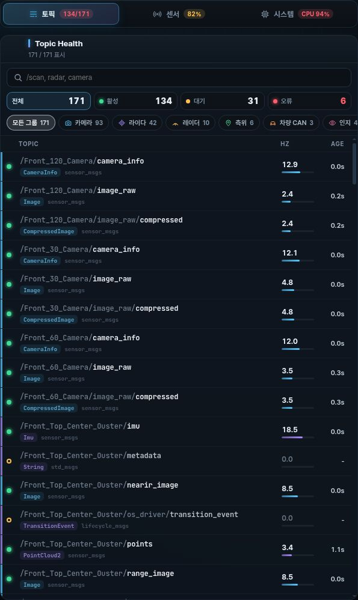 | 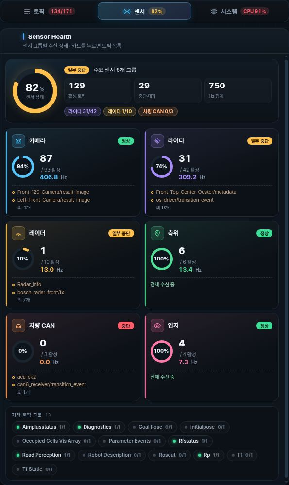 | 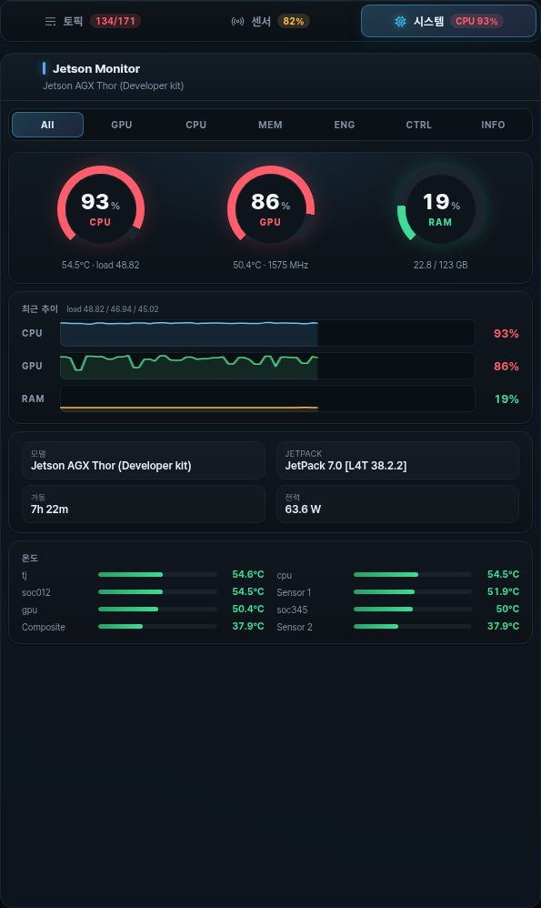 |

- **토픽**: 검색창, `전체 / 활성 / 대기 / 오류` 개수(눌러서 필터), 카메라·라이다 등 그룹 필터, 토픽별 Hz와 경과 시간
- **센서**: 전체 센서 상태 링, 그룹별 카드(활성 비율, 활성 토픽 수, Hz 합계, 끊긴 토픽 이름), 기타 토픽 그룹. 카드를 누르면 해당 토픽 목록으로 이동합니다.
- **시스템**: CPU·GPU·RAM 링, 최근 추이 그래프, 보드 정보, 온도. 항목별 상세는 위쪽 탭(GPU, CPU, MEM …)에 있습니다.

## 차선 인식 범위 설정

⚙ → **도로 인지**에서 카메라마다 차선을 찾을 바닥 범위를 지정합니다. 저장하면 재시작 없이 1~2초 뒤 인지 노드에 반영됩니다(`road_perception/config/ipm/<카메라>.yaml`).

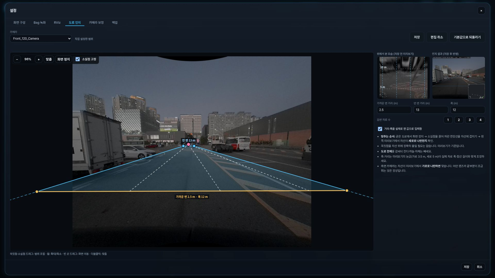

**맞추는 순서**

1. 곧은 도로가 보일 때 **화면 정지**를 누릅니다.
2. 분홍색 소실점을 끌어 파란 연장선을 차선에 겹칩니다(**소실점 고정**이 켜져 있으면 사다리꼴이 소실점을 따라갑니다).
3. **위에서 본 모습**에서 차선이 세로로 나란한지 봅니다. 측면 카메라는 가로로 나란하면 맞습니다.
4. **가까운 변·먼 변 거리, 폭**을 실제 크기로 입력합니다. 미리보기 눈금은 가로 3.5 m, 세로 5 m입니다. **감쌀 차로 수** 버튼으로 폭을 빠르게 넣을 수 있습니다.
5. **저장**합니다. 창 아래 [저장]을 눌러도 편집 중인 범위가 함께 저장됩니다.

**범위는 내 차로가 아니라 도로 전체**를 감싸세요. 그래야 옆 차선과 중앙선도 인식합니다. 잔디, 하늘, 차체는 빼세요.

휠로 확대·축소, 빈 곳 드래그로 이동, 더블클릭으로 맞춤입니다. 도로 인지 탭의 보정이 켜져 있으면 왜곡을 편 영상 위에서 맞추지만, 파일에는 항상 원본 영상 기준으로 저장되므로 체크박스를 바꿔도 범위가 어긋나지 않습니다.

## 카메라 보정

체커보드로 카메라 렌즈 왜곡을 구하고 적용합니다. 보정 도구는 `road_perception` 패키지에 있으며, **⚙ → 카메라 보정** 탭을 열 때 켜지고 닫으면 꺼집니다. 카메라 노드만 돌고 있으면 사용할 수 있고, 카메라 설정은 바꾸지 않습니다.

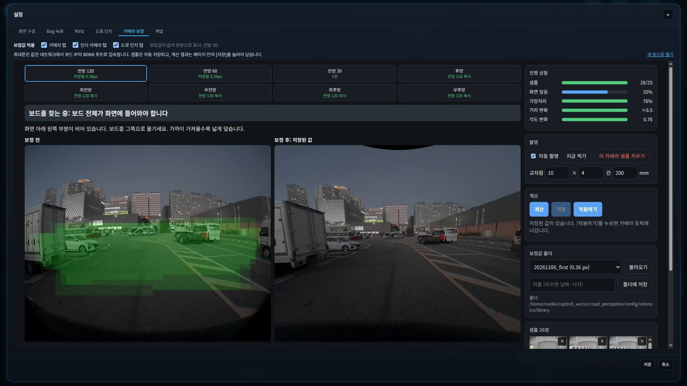

*왼쪽 보정 전, 오른쪽 보정 후. 왼쪽의 초록 영역은 지금까지 샘플로 덮은 범위입니다.*

### 촬영과 계산

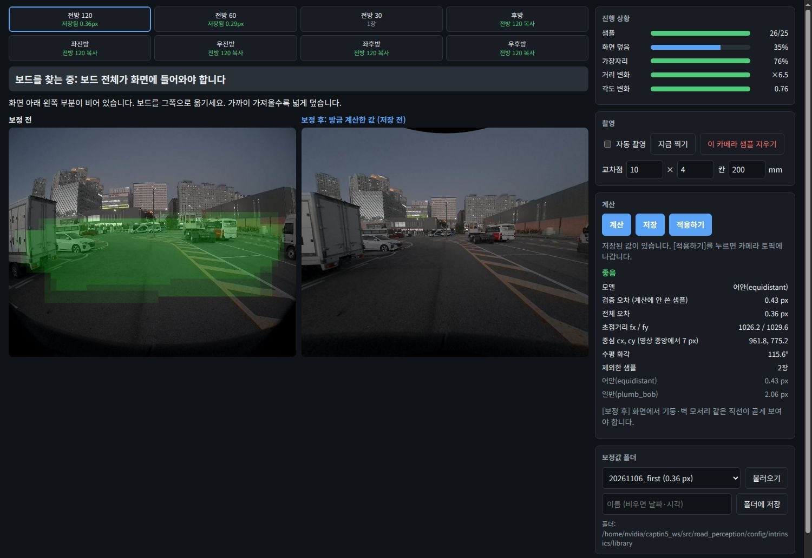

1. 위쪽에서 카메라를 고릅니다.
2. 보드 **전체**가 화면에 들어오게 두고 3초쯤 멈추면 자동으로 찍힙니다. 보드는 기본 내부 교차점 10×4, 칸 200 mm이며 화면에서 바꿀 수 있습니다.
3. 안내 문구와 **진행 상황** 막대를 보며 위치, 거리, 각도를 바꿔 25장 정도 모읍니다. 왜곡은 화면 가장자리에서 측정되므로 좌우 끝까지 옮겨 찍으세요.
4. **계산**을 누릅니다. 어안(`equidistant`)과 일반(`plumb_bob`) 모델을 모두 계산해, 계산에 쓰지 않은 샘플의 오차로 고릅니다. 다른 샘플과 크게 어긋나는 샘플은 자동으로 제외합니다.
5. 오른쪽 **보정 후** 화면에서 기둥·벽 모서리 같은 직선이 곧은지 확인합니다.
6. **저장**한 뒤 **적용하기**를 누릅니다.

| 버튼 | 동작 |
|---|---|
| **저장** | 계산 결과를 그 카메라가 쓰는 값으로 저장합니다. 세 탭은 이 파일을 바로 읽습니다. |
| **적용하기** | 저장된 값을 돌고 있는 카메라 노드에 넣어 `/<카메라>/camera_info`로 내보냅니다. 재시작이 필요 없습니다. |

판정 기준은 검증 오차 0.6 px 미만 **좋음**, 1.2 px 미만 **보통**, 그 이상 **나쁨**입니다. 이 기준은 도구에 정한 경험값입니다.

**휴대폰으로 보기**: 보드를 옮기면서 보려면 같은 네트워크의 휴대폰에서 `http://<보드 IP>:8090`에 접속합니다. 설정 창을 닫으면 도구가 꺼지니 탭을 열어 두세요.

### 보정값이 없는 카메라

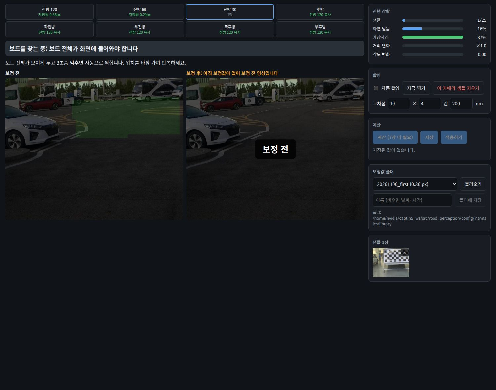

보정 후 칸에 원본 영상과 함께 **보정 전**이 표시됩니다. 화면이 계산 결과를 보여 주면 제목이 `보정 후: 방금 계산한 값 (저장 전)`으로 바뀝니다.

### 보정값 폴더

**보정값 폴더** 칸에서 값을 이름 붙여 보관하고 다시 불러옵니다.

```
road_perception/config/intrinsics/
├── Front_120_Camera.yaml                  # 그 카메라가 지금 쓰는 값
└── library/
    └── Front_120_Camera/20261106_first.yaml   # 보관한 값
```

- **폴더에 저장**: 지금 쓰는 값을 입력한 이름으로 보관합니다. 이름을 비우면 날짜·시각을 쓰고, 같은 이름은 거부합니다.
- **불러오기**: 고른 값을 선택한 카메라가 쓰는 값으로 복사합니다. 다른 카메라의 값도 고를 수 있으며, 화면에 `전방 120 복사`처럼 표시됩니다. 해상도가 다르면 거부합니다.
- **자동 백업**: 지금 값을 덮어쓸 때 폴더에 같은 값이 없으면 `auto_<시각>` 이름으로 먼저 보관합니다.
- 폴더의 값을 지우는 버튼은 없습니다. 필요 없는 파일은 직접 지우세요.

같은 렌즈를 쓰는 여러 카메라에 한 번에 복사하려면 터미널에서 실행합니다. 직접 보정한 값은 `--force` 없이 덮어쓰지 않습니다. 원본 카메라를 다시 보정하면 복사도 다시 해야 합니다.

```bash
ros2 run road_perception apply_camera_info --copy-from Front_120_Camera \
  --camera Left_Front_Camera --camera Left_Rear_Camera \
  --camera Right_Front_Camera --camera Right_Rear_Camera --camera Rear_Camera
```

### 탭별 보정 적용

**⚙ → 카메라 보정** 맨 위의 체크박스로 탭마다 켜고 끕니다. 기본은 모두 켜짐입니다. 설정은 `road_perception/config/calibration_apply.yaml`에 저장되어 모든 브라우저에 공통으로 적용되고, 인지 노드에는 재시작 없이 1~2초 안에 반영됩니다.

| 체크박스 | 처리 위치 | 켰을 때 | 인식 결과 영향 |
|---|---|---|---|
| 카메라 탭 | 웹 모니터 | 미리보기와 확대 창의 영상만 폄 | 없음 |
| 인지 카메라 탭 | `object_3d` | 입력 프레임을 펴서 검출·깊이 추정·결과 영상에 사용 | **있음** |
| 도로 인지 탭 | `road_perception` | 입력 프레임을 펴서 차선·신호등·표지판 인지에 사용. 범위 편집도 편 영상 기준 | **있음** |

- 인지 결과 영상 HUD의 `RECT`가 적용 표시입니다.
- `image_raw` 토픽 자체는 항상 왜곡된 원본입니다.
- 도로 인지 탭을 켜면 메시지의 `image_points`, 신호등·표지판 박스 좌표도 편 영상 기준이 됩니다.
- 세 탭은 저장된 파일을 읽으므로 **저장이나 불러오기만 해도 반영**됩니다. **적용하기**는 `camera_info` 토픽에만 해당합니다.
- 카메라 노드는 다음 재시작부터 `multi_v4l2_gmsl_cam.launch.py`의 `camera_info_url`로 같은 파일을 읽습니다.

## RViz Monitor (RViz 탭)

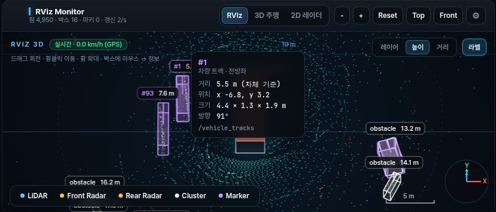

*차량 트랙 #1 에 마우스를 올린 모습. 차체 기준 거리·위치·크기·방향·토픽이 표시됩니다*

- **포인트 색상**: 오른쪽 위에서 **레이어 색 / 높이 / 거리** 선택(기본 높이). 파랑→빨강 색상표, 겹칠수록 밝아지는 발광 표현
- **바닥**: 멀수록 옅어지는 격자, 차량 중심 기준 거리 링(5·10·20·30·50 m …)과 거리 라벨
- **박스**: 바닥·윗면 반투명 채움 + 모서리 + 진행 방향 선. 차체에서 7 m 안이면 강조. 라벨 `#트랙ID 거리`는 겹치지 않게 가까운 것부터 최대 40개(**라벨** 버튼으로 끄기)
- **마우스 툴팁**: 박스에 올리면 ID, 종류, 방위, 차체 기준 거리, 위치, 크기, 방향
- **자차**: [차량 위치](#차량-위치-좌표계) 설정의 실제 차체(기본 8.2 × 3.0 m, 전방 +y)와 진행 방향 화살표
- **시점**: Top / Front / Left / Right / Reset 은 차량 전방 기준이며 0.35초 동안 부드럽게 전환. 드래그 회전, 휠클릭 드래그 이동, 휠 확대
- **클러스터 장애물**: `/cluster_boxes` 다각형을 레이어 색으로 그립니다. [장애물 다각형 표시](#장애물-다각형-표시) 참고
- **보조 표시**: XYZ 방향 표시(오른쪽 아래), 축척 막대(1·2·5 단위), `실시간/Play · 속도` 배지, `점 · 박스 · 마커 · 초당 갱신` 통계, 근접 장애물 경고 배너
- **병합 클라우드 대체 표시**: LiDAR 레이어 토픽(`/Multi_Lidar_pointcloud`)에 데이터가 없으면, 개별 라이다를 `multi_lidar_merge.yaml`과 같은 변환으로 병합 좌표계에 옮겨(자차 영역 제거 포함) 대신 그립니다

## 차량 위치 (좌표계)

데이터 좌표계는 `multi_lidar_merge`의 `output_frame`입니다. 이 차량은 **전방 +y, 좌측 −x**입니다. 앞쪽 상단 Ouster가 y = +3.6~4.9 m, 뒤쪽 상단 Ouster가 y = −2.3 m에 있습니다. 차체 기본값은 병합 노드의 `remove_vehicle` 영역(x −1.3~1.7, y −2.5~5.7)입니다.

자차 표시, 방위(전방/후방/좌/우), 차체 기준 거리, 근접 경고, 감지 객체 목록, 주행 뷰가 모두 이 차체를 기준으로 계산됩니다. ⚙ → **RViz** → **차량 위치**에서 전방 방향(+x / +y / −x / −y), 중심 x·y, 길이·폭·높이를 바꿀 수 있습니다.

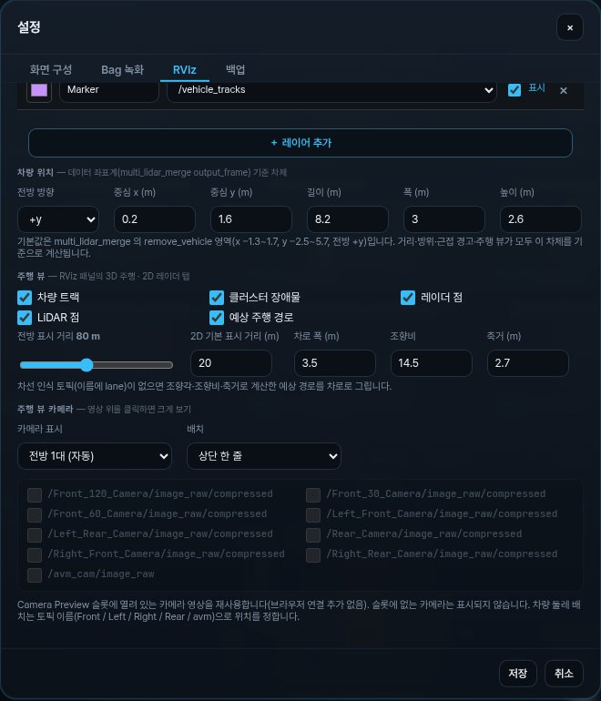

### 레이더 (전방 can5 · 후방 can4)

Bosch 레이더 객체(`can_parser_msgs/RadarMsg`: `/front_radar_objects`, `/rear_radar_objects`)를 RViz 탭, 3D 주행, 2D 레이더, 대시보드 3D 주행에 점으로 그립니다.

- 레이더 원값(`dx` 전방, `dy` 좌측)을 차체 기준으로 바꿔 그립니다. 원점은 전방 레이더 = 앞 범퍼 중앙, 후방 레이더 = 뒤 범퍼 중앙입니다(후방 레이더 `dx` 는 뒤쪽이 음수). 실제 장착 위치가 다르면 **차량 위치**의 전방/후방 레이더 위치(m, +전방)로 맞춥니다.
- 실제 데이터 범위(2026-11-11): 전방 dx +20~150 m, 후방 dx −10~−150 m, 각각 20여 개 객체.
- RViz 탭: 레이어 토픽이 레이더 토픽(`/front_radar_objects` 또는 `/radar_markers/front` 처럼 front/rear 가 들어간 레이더 토픽)이면 그 레이어 색으로, 기본 `Radar` 레이어는 토픽을 비워 두면 전방·후방 모두 그립니다. `/radar_markers/*` 는 RViz 용으로 축을 뒤집은 좌표라 `RadarMsg` 가 있으면 직접 그리지 않습니다.

| RViz 탭 (Front Radar · Rear Radar 레이어) | ⚙ → RViz → 차량 위치 |
|---|---|
| 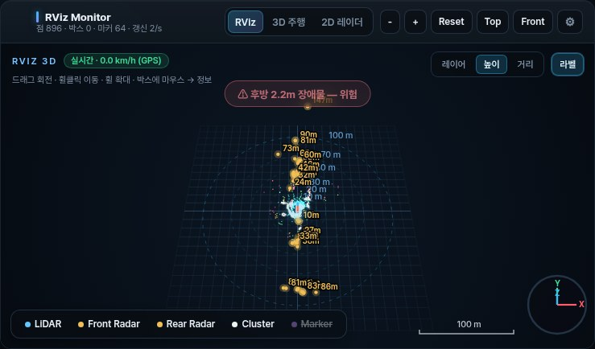 | 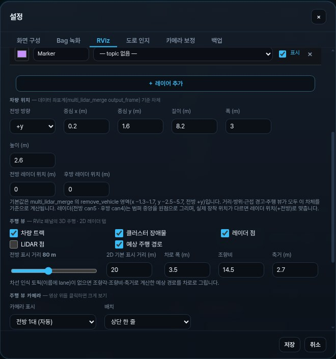 |

*RViz 탭: 전방 레이더 점은 차 앞, 후방 레이더 점은 차 뒤에 거리 라벨과 함께 표시. 설정: 레이더 위치는 범퍼 중앙 기준(m, +전방)*

## 주행 뷰 (3D 주행 / 2D 레이더)

RViz 패널의 **3D 주행**, **2D 레이더** 탭입니다. 트랙, 클러스터, 레이더, LiDAR, 차량 정보, 카메라를 차량 기준(차체 중심, 전방이 위)으로 모아 보여 줍니다.

| 3D 주행 (카메라 전체 9대, 차량 둘레 배치, LiDAR 켬) | 2D 레이더 (기본 20 m, 눈금 2 m) |
|---|---|
| 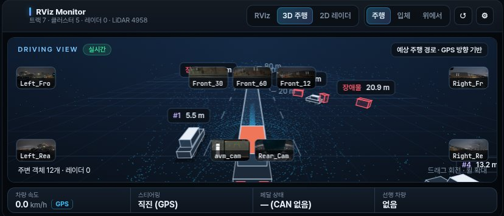 | 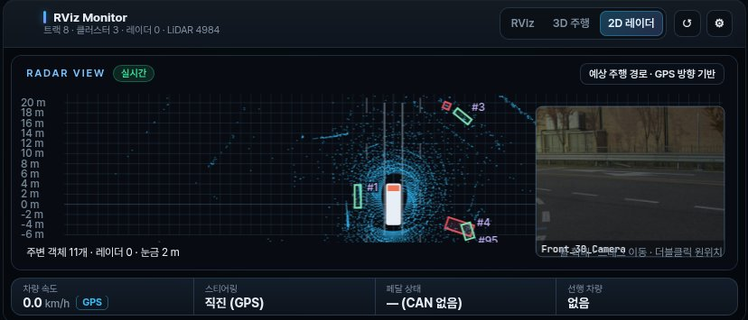 |

- **3D 주행**
  - 자차와 차량 트랙은 차량 모형, 클러스터는 바닥의 빨간 [다각형](#장애물-다각형-표시), 레이더는 보라색 점으로 그립니다. 라벨은 `#트랙ID 거리`, `장애물 거리`입니다.
  - 내 차로 안에서 가장 가까운 앞 객체를 **LEAD**(초록)로 표시하고, 앞 범퍼에서 LEAD까지 파란 빔을 그립니다. 거리 = 앞 범퍼 ~ 그 차 뒷면입니다.
  - 시점은 **주행 / 입체 / 위에서**입니다. 드래그로 회전, 휠로 확대, ↺로 초기화합니다.
- **2D 레이더**
  - 위에서 본 평면에 거리 눈금, 차로 점선, 트랙 ID, 레이더 거리, 장애물, LEAD를 표시합니다.
  - 기본 표시는 **전방 20 m**이고, 후방은 차체 뒤끝 + 2 m 이상 보입니다.
  - **휠로 마우스 위치 기준 확대**(약 3 m~250 m), **드래그로 이동**, **더블클릭**이나 ↺로 원위치합니다. 눈금(0.5 / 1 / 2 / 5 m …)은 확대에 맞춰 바뀌고, 글자가 겹치지 않게 간격을 유지합니다.
- **움직임 표시**: 지면 격자와 차선 점선이 차량 속도만큼 뒤로 흐릅니다. 속도·조향은 CAN(`/acu_ck2_ver2`)에서 가져오고, 없으면 **`GPSFix` 속도·진행방향**을 씁니다. 이때 `GPS` 표시가 붙고, 예상 경로는 GPS 회전율로 휩니다.
- **하단 정보 줄**: 차량 속도(기어 또는 GPS), 스티어링(좌/우 각도, GPS면 회전율 °/s), 페달 상태, 선행 차량 거리
- **카메라**: 표시 안 함 / 전방 1대(자동) / 전체 / 직접 선택. 배치는 **상단 한 줄**(2D는 오른쪽 세로 열) 또는 **차량 둘레**(토픽 이름의 Front·Left·Right·Rear·avm으로 위치 결정)입니다. 타일을 클릭하면 크게 봅니다. 선택한 카메라는 실시간 이름으로 저장되어 Play에서는 자동으로 `/bagplay/...` 영상을 씁니다.
- 주소 뒤에 `?vtab=drive3d` 또는 `?vtab=radar2d`를 붙이면 해당 탭이 바로 열립니다.

| 표시 | 출처 |
|---|---|
| 차량 트랙 | `kind=track` 박스 (예: `/vehicle_tracks` MarkerArray CUBE, `ns=vehicle_tracks`, ID = `marker.id`) |
| 클러스터 장애물 | `/cluster_boxes` 다각형(없으면 Detection3DArray / 객체 MarkerArray 박스). 트랙과 1.6 m 안으로 겹치거나 차체 안의 것은 생략 |
| 레이더 점 | `can_parser_msgs/RadarMsg` (`/front_radar_objects`, `/rear_radar_objects`)의 유효 객체를 [레이더 장착 위치](#레이더-전방-can5--후방-can4) 기준으로 변환 |
| LiDAR 점 | RViz **LiDAR** 레이어 토픽. 없으면 병합 좌표계로 변환한 개별 라이다 |
| 차선 | 토픽 이름에 `lane`이 들어간 LINE_STRIP / LINE_LIST 마커. **없으면 예상 주행 경로를 차로로 표시** |
| 속도·조향·페달 | `/acu_ck2_ver2`, 없으면 `/gpsfix`(속도·진행방향). Play 뷰에서는 `/bagplay/...` |

**설정**은 ⚙ → **RViz** → **주행 뷰** / **주행 뷰 카메라**에서 하며, 저장하면 백업 파일에도 들어갑니다.

| 항목 | 기본값 | 설명 |
|---|---|---|
| 표시 레이어 | 트랙·클러스터·레이더·예상 경로 켬, LiDAR 끔 | 레이어별 표시 여부 |
| 전방 표시 거리 | 80 m | 3D 차로 길이 |
| 2D 기본 표시 거리 | 20 m | 2D 처음 확대 범위 (↺·더블클릭 시 복귀) |
| 차로 폭 / 조향비 / 축거 | 3.5 m / 14.5 / 2.7 m | 예상 경로 계산용. **조향비·축거는 추정치이므로 실제 차량 값으로 바꿔야 정확합니다** |
| 카메라 표시 / 배치 | 전방 1대(자동) / 상단 한 줄 | 위 설명 참고 |

### 장애물 다각형 표시

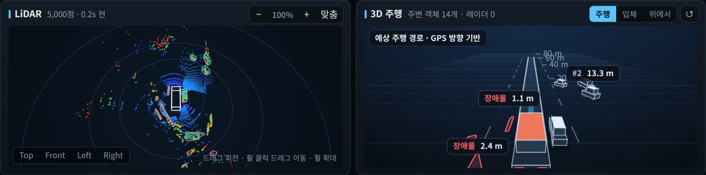

*왼쪽: LiDAR 뷰의 빨간 윤곽선. 오른쪽: 3D 주행 뷰의 바닥 다각형과 차량 모형(트랙)*

`lidar_cluster_detector`의 `/cluster_boxes`는 3D 박스 대신 클러스터를 위에서 본 볼록 윤곽을 클러스터 맨 아래 높이에 그린 `LINE_STRIP` 다각형으로 나옵니다. 네임스페이스는 `cluster_boxes` 그대로라 RViz2 설정은 바꾸지 않아도 됩니다.

| 화면 | 표시 |
|---|---|
| 3D 주행 / 2D 레이더 / 대시보드 3D 주행 | 바닥에 깔린 반투명 다각형, LEAD면 초록색 |
| RViz 탭 / 대시보드 LiDAR | 다각형 선 |
| 다각형이 없는 예전 bag | 기존처럼 `/cluster_detections` 박스 |

- `/cluster_detections`는 차량 트래커 입력이라 박스 형식 그대로입니다. 감지 객체 목록과 근접 경고도 이 박스를 씁니다.
- 클러스터는 종류를 구분하지 못하므로 차량도 `/cluster_boxes`에서는 다각형입니다. 차량으로 판단된 것은 `/vehicle_tracks` 박스·차량 모형으로 함께 나오며, 3D 주행 뷰에서는 겹치는 다각형을 숨깁니다.
- 볼록 윤곽이라 ㄱ자처럼 오목한 덩어리는 안쪽 빈 공간까지 포함해 그려집니다.

## 카메라

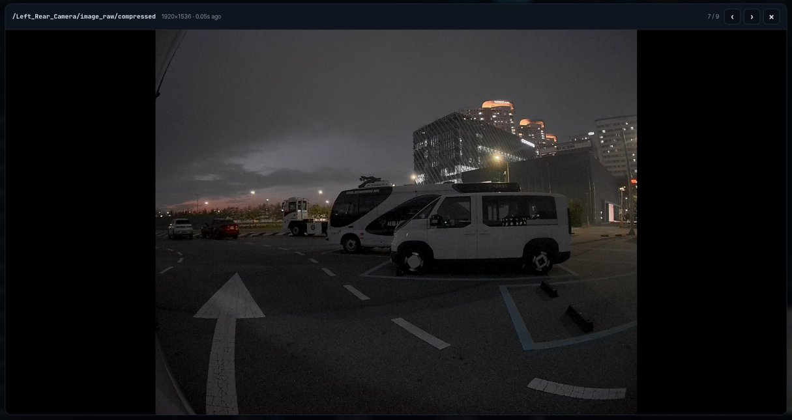

- **확대 보기**: Camera Preview 영상이나 주행 뷰 카메라 타일을 클릭하면 크게 봅니다. **‹ ›** 또는 **←/→** 키로 카메라를 바꾸고, **Esc**나 바깥 클릭으로 닫습니다. 제목줄에 토픽, 해상도, 마지막 프레임 경과 시간, 순번이 나옵니다.
- **스트림 포트 분산**: 브라우저는 호스트:포트당 동시 연결이 6개입니다. 그래서 카메라 슬롯을 스트림 포트 3개(8081~8083)에 순서대로 나눠 연결합니다. 포트 3개로 최대 18대까지 볼 수 있습니다.
- **연결 관리**: 슬롯을 다시 만들거나 토픽이 바뀔 때 이전 MJPEG 연결을 즉시 끊습니다. 뒤늦게 나타난 카메라(예: Play 시작 직후의 `/bagplay` 토픽)는 새로고침 없이 자동으로 연결합니다.
- **재사용**: 주행 뷰 카메라는 Camera Preview에 열린 영상을 다시 그리므로 브라우저 연결을 더 쓰지 않습니다. 대신 Camera Preview 슬롯에 없는 카메라는 표시할 수 없습니다.
- **확대 해상도**: 미리보기 격자는 960 px 축소본이고, 확대 창은 원본 해상도 스트림(`?full=1`)을 하나 더 엽니다.

## Bag 녹화 / 재생

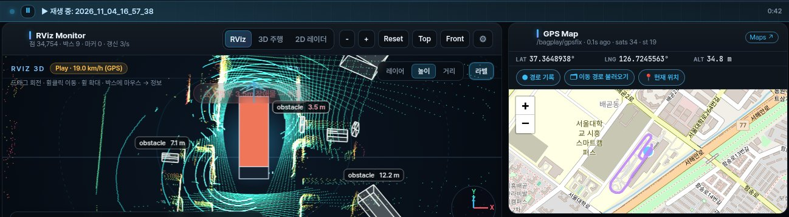

*Play 뷰: 재생 바, RViz 탭(bag 에 병합 클라우드가 거의 없어 개별 라이다 8대를 변환해 표시, GPS 속도 표시), GPS 지도의 bag 전체 경로(보라)*

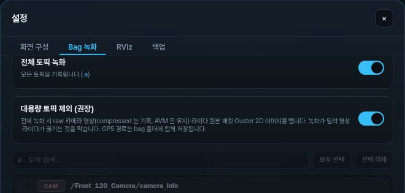

- **대용량 토픽 제외 (기본 켬)**: 전체 녹화(`-a`) 시 raw 카메라 영상(`*/image_raw`, compressed는 기록, AVM은 raw뿐이라 유지), 라이다 원본 패킷(`velodyne_packets`), Ouster 2D 이미지(`nearir/range/reflec/signal_image`), `/cluster_debug_points`를 뺍니다. 재생 중인 `/bagplay/...` 토픽은 항상 뺍니다. 설정 → **Bag 녹화**에서 끌 수 있습니다.
- **GPS 경로 동시 기록**: Bag 녹화 중에는 GPS 경로가 함께 기록되어 지도에 노란 선으로 보입니다. 녹화를 멈추면 bag 폴더의 `gps_track.json`과 `log/gps/track_bag_<bag>.json`에 저장됩니다.
- **Play 시 경로 표시**: bag을 재생하면 그 bag의 전체 경로를 지도에 **보라색**으로 그립니다. `gps_track.json`이 없는 기존 bag은 bag 안의 `/gpsfix`(없으면 NavSatFix 토픽)에서 경로를 뽑아(35 GB bag 기준 약 5초) `gps_track.json`으로 저장해 둡니다.
- **Play 화면 보완**:
  - 병합 클라우드가 없으면 개별 라이다로 대체 표시합니다.
  - CAN이 없으면 GPS 속도·진행방향으로 움직임을 표시합니다.
  - 녹화 공백이 재생되는 것을 감안해, Play에서는 `NO SIGNAL` 판정을 6초로 늘립니다(실시간 3초).

## 요구 사항

- ROS 2 Jazzy (Ubuntu 24.04, Jetson AGX Thor에서 검증)
- Python 패키지: `rclpy`, `sensor_msgs`, `sensor_msgs_py`, `rosidl_runtime_py`, `rosbag2_py`, `python3-opencv`, `python3-numpy`, `python3-pil`, `python3-yaml`
- 선택:
  - [jetson-stats](https://github.com/rbonghi/jetson_stats) (`jtop`): 시스템 탭 데이터용
  - `rosbags`: ROS 1 `.bag` 재생용. 처음 쓸 때 `~/.local/share/ros_web_monitor/rosbags_venv`에 자동 설치됩니다.
  - `multi_lidar_merge` 패키지 설치(`share/multi_lidar_merge/config/multi_lidar_merge.yaml`): 라이다 변환·자차 영역 대체 표시용
  - `torch`, `torchvision` (CUDA): 카메라 미리보기 GPU 변환. 없으면 CPU로 변환합니다.
  - `road_perception` 패키지: 차선 범위 편집, 카메라 보정. 없으면 이 기능만 꺼지고 나머지는 동작합니다.
- 브라우저에서 CDN에 접속할 수 있어야 합니다(Leaflet 지도, 웹 폰트). 오프라인이면 지도가 표시되지 않고, 글꼴은 시스템 기본 폰트로 대체됩니다.

## 빌드 및 실행

```bash
cd ~/captin5_ws
colcon build --packages-select ros_web_monitor
source install/setup.bash

ros2 launch ros_web_monitor monitor.launch.py
# 또는 전체 시스템과 함께: ros2 launch bringup run.launch.xml
```

브라우저에서 `http://<host>:8080`에 접속합니다. 기본값은 `http://192.168.1.100:8080`입니다. 다른 네트워크(예: 와이파이 휴대폰)에서 보려면 아래처럼 `host:=0.0.0.0`으로 실행합니다.
웹 파일(`web/`)만 바꿨다면 빌드 후 브라우저 새로고침(Ctrl+Shift+R)으로 적용되고, `monitor_node.py`를 바꿨다면 노드를 다시 실행해야 합니다.

```bash
ros2 launch ros_web_monitor monitor.launch.py host:=0.0.0.0 port:=8080
```

## 파라미터

| 이름 | 기본값 | 설명 |
|---|---|---|
| `host` | `0.0.0.0` (launch: `192.168.1.100`) | HTTP 서버 바인드 주소 |
| `port` | `8080` | 대시보드, API 포트 |
| `stream_port` | `8081` | 카메라 MJPEG 스트림 전용 첫 포트 |
| `stream_port_count` | `3` | 스트림 포트 개수(`stream_port` ~ `stream_port+count-1`). 포트 3개 → 카메라 최대 18대 |
| `scan_period_sec` | `2.0` | 토픽 목록 갱신 주기 |
| `rate_window_sec` | `5.0` | Hz 계산 구간 |
| `subscribe_all` | `true` | 모든 토픽 자동 구독 |
| `visual_max_points_per_topic` | `900` | RViz 패널에 보내는 토픽당 최대 포인트 수 (화면에서도 변경 가능) |
| `prune_after_sec` | `10.0` | 사라진 토픽을 목록에서 정리하기까지의 시간 |
| `bag_dir` | `/home/nvidia/robot_ws/bag` | Bag 녹화, 재생 기본 폴더 (화면에서 변경 가능) |
| `preview_width` / `preview_fps` / `preview_quality` | `960` / `12` / `75` | 카메라 미리보기 축소 변환. `preview_width`가 0이면 끔 |
| `road_ipm_dir` | `~/captin5_ws/src/road_perception/config/ipm` | 차선 인식 범위 파일 폴더 |
| `road_cameras_config` | (비움) | 도로 인지 카메라 설정. 비우면 `road_perception` 패키지의 `config/cameras.yaml` |
| `lens_calibrator_port` | `8090` | 보정 도구 포트 |
| `calibration_apply_file` | `~/captin5_ws/src/road_perception/config/calibration_apply.yaml` | 탭별 보정 적용 설정 파일 |
| `intrinsics_dir` | `~/captin5_ws/src/road_perception/config/intrinsics` | 보정값 폴더 |

### 성능 관련 동작

- **카메라 미리보기 축소**: 브라우저로 원본 1920×1536 JPEG를 보내지 않고, 보고 있는 토픽만 960 px로 줄여 보냅니다. 처리는 GPU(nvJPEG), 안 되면 CPU입니다. 적용 당시 측정에서 브라우저 CPU가 68%에서 26%로 줄었습니다.
- **raw 영상 구독 제거**: 같은 이름의 `/compressed` 토픽이 있으면 raw `Image`는 구독하지 않고 compressed 수신률로 표시합니다.
- **왜곡 펴기**: 켠 탭의 보고 있는 영상만 GPU로 변환합니다. 후방 카메라 탭 영상은 켜든 끄든 4.3 fps로 같았고, Front_120 인지 처리는 켰을 때 108~137 ms, 껐을 때 104~108 ms였습니다(측정 편차 있음).
- 화면에 쓰지 않는 대용량 메시지(raw `Image`, `VelodyneScan`, Ouster `PacketMsg`)는 역직렬화하지 않고 바이트로만 받아 Hz와 크기를 셉니다. raw 영상의 해상도와 인코딩은 메시지 앞부분만 읽어 표시합니다.
- PointCloud2 다운샘플은 numpy로 처리합니다.

## 화면 설정 저장과 기본 설정 파일

레이아웃, 카메라 슬롯, RViz 레이어·색상 모드, 차량 위치, 주행 뷰 같은 화면 설정은 **브라우저 localStorage**에 저장됩니다.
따라서 다른 브라우저나 다른 주소(`localhost` ↔ IP)로 접속하거나 브라우저 데이터를 지우면 설정이 비어 있습니다.

이를 보완하기 위해 저장소의 [`UI/`](UI/) 폴더에 기본 설정 파일을 둡니다.

- 브라우저에 저장된 설정이 없으면 페이지를 열 때 `UI/*.json` 중 **가장 최신 파일**(파일명 순)을 자동으로 적용합니다.
- ⚙ 설정 → **백업** 탭
  - **⬇ UI 폴더에 설정 백업 저장**: 화면 설정(대시보드 포함)과 서버에 저장된 값(Bag 저장 경로, 탭별 보정 적용, 카메라 보정값과 보관 폴더, 차선 인식 범위)을 보드의 `~/captin5_ws/src/ros_web_monitor/UI`에 JSON으로 저장(파라미터 `ui_settings_dir`)
  - **⬆ UI 폴더에서 백업 불러오기**: 폴더의 백업 목록에서 골라 복원. 서버에 저장된 값은 확인 창에서 복원 여부를 고릅니다. 바뀌는 보정값은 보관 폴더에 `auto_<시각>`으로 남고, 보관 폴더의 기존 항목은 지우지 않습니다. `camera_info` 토픽은 카메라 보정 탭의 **적용하기**로 반영합니다
  - **📄 UI 폴더 최신 화면 설정으로 교체**: `UI/`의 최신 파일로 화면 설정을 강제 교체

백업 탭에서 저장한 파일은 바로 `UI/`의 최신 파일이 되므로, 브라우저 설정이 없는 접속자에게 이 화면 설정이 자동 적용됩니다.

## 재부팅 / 종료 버튼 설정

기존 화면의 **⟳ 재부팅**, **⏻ 종료** 버튼과 대시보드의 **재부팅**, **종료** 버튼은 `sudo -n`으로 실행됩니다. 처음 한 번 비밀번호 없는 sudo를 허용해야 합니다.

```bash
echo "$USER ALL=(root) NOPASSWD: /usr/sbin/shutdown, /usr/sbin/reboot" \
  | sudo tee /etc/sudoers.d/ros_web_monitor_power && sudo chmod 440 /etc/sudoers.d/ros_web_monitor_power
```

## HTTP API

| 메서드 | 경로 | 설명 |
|---|---|---|
| GET | `/`, `/app.js`, `/app.css` | 대시보드 (`?vtab=rviz\|drive3d\|radar2d`로 RViz 패널 탭 지정) |
| GET | `/cockpit`, `/cockpit.js`, `/cockpit.css` | [대시보드](#대시보드-cockpit) 페이지 |
| GET | `/api/state` | 전체 상태 스냅샷 (토픽, 카메라, 시스템, GPS·속도·진행방향, 차량, 스트림 포트 등) |
| GET | `/events` | 상태 실시간 푸시 (Server-Sent Events) |
| GET | `/stream?topic=<topic>` | 카메라 MJPEG 스트림 (각 스트림 포트에서도 제공). `full=1` 원본 해상도, `rect=1` 왜곡을 편 영상 |
| GET | `/api/road_perception/ipm` | 카메라별 차선 인식 범위 (`rect`: 꼭짓점이 편 영상 기준인지) |
| GET | `/api/calibration_apply` | 탭별 보정 적용 설정, 카메라별 보정값 유무 |
| GET | `/api/lens_calibrator` | 보정 도구 실행 상태 |
| GET | `/api/settings/server-backup` | 백업에 넣을 서버 저장 값 |
| GET | `/api/settings/ui-list`, `/api/settings/ui-file?name=` | UI 폴더의 백업 목록, 파일 내용 |
| GET | `/api/ui/default-settings` | `UI/` 폴더의 최신 화면 설정 JSON |
| GET | `/api/bag/play/list` | 재생 가능한 bag 목록 |
| GET | `/api/bag/play/track` | 재생 중인 bag 의 GPS 경로 (`status`: loading / ready / none) |
| GET | `/api/gps/track/list`, `/api/gps/track/load?file=` | 저장된 GPS 이동 경로 |
| GET | `/api/fs/list?path=` | Bag 저장 폴더 탐색 |
| POST | `/api/viz-config` | RViz 패널 설정 반영 |
| POST | `/api/bag/config`, `/api/bag/start`, `/api/bag/stop` | Bag 녹화 (`start` body: `all`, `topics`, `light`) |
| POST | `/api/bag/play/{start,stop,pause,resume,next,seek,rate}` | Bag 재생 제어 |
| POST | `/api/gps/track/{start,stop,delete}` | GPS 이동 경로 기록 |
| POST | `/api/fs/mkdir` | Bag 저장 폴더 생성 |
| POST | `/api/road_perception/ipm`, `/api/road_perception/ipm/reset` | 차선 인식 범위 저장 / 기본값으로 되돌리기 |
| POST | `/api/calibration_apply` | 탭별 보정 적용 설정 저장 (`camera`, `perception`, `road`) |
| POST | `/api/lens_calibrator/{start,stop}` | 보정 도구 켜기 / 끄기 |
| POST | `/api/settings/ui-save` | 설정 백업을 UI 폴더에 저장 |
| POST | `/api/settings/server-restore` | 백업의 서버 저장 값 복원 |
| POST | `/api/system/reboot`, `/api/system/shutdown` | 보드 전원 제어 |

## 디렉터리 구조

```
ros_web_monitor/
├── ros_web_monitor/
│   ├── monitor_node.py      # ROS 2 노드 + HTTP 서버 + API
│   └── web/                 # 프런트엔드 (index.html, app.js, app.css, 대시보드 cockpit.html/js/css)
├── launch/monitor.launch.py
├── UI/                      # 기본 화면 설정 JSON (자동 적용)
├── docs/                    # README 스크린샷
├── log/gps/                 # GPS 이동 경로 저장 (git 제외)
├── package.xml
└── setup.py
```

## 문제 해결

- **페이지가 뜨지 않음**: `host` 파라미터의 주소로 접속했는지 확인하세요. launch 기본값은 `192.168.1.100`이라 `localhost`로는 접속할 수 없습니다.
- **와이파이 휴대폰에서 접속이 안 됨**: 휴대폰(`192.168.50.x`)은 `192.168.1.100`과 다른 대역이고, launch 기본값은 그 주소로만 접속을 받습니다. `host:=0.0.0.0`으로 실행하고 `http://192.168.50.100:8080`으로 접속하세요. 모니터에 로그인이 없으므로 믿을 수 있는 네트워크에서만 쓰세요. 보정 도구(8090)는 켜져 있는 동안 모든 주소에서 접속을 받습니다.
- **보정 탭에 "모니터를 다시 시작해야…"가 나옴**: 빌드 후 모니터를 다시 실행하지 않은 상태입니다.
- **체커보드가 검출되지 않음**: 보드 전체가 화면에 들어와야 합니다. 일부만 보이면 검출되지 않습니다. 망원 카메라는 보드를 멀리 두세요. 반사가 심하면 방향을 바꾸세요.
- **보정 후 화면에 검은 여백이 보임**: 왜곡을 펴면서 생기는 정상 여백입니다. 차선 탐색에서는 자동으로 제외됩니다.
- **화면 설정이 초기화됨**: 접속 주소나 브라우저가 바뀌었기 때문입니다. `UI/` 기본 설정이 자동 적용되며, 필요하면 백업 탭에서 다시 불러오세요.
- **시스템 탭이 비어 있음**: `jtop`이 설치되어 있고 `jtop.service`가 실행 중인지 확인하세요.
- **재부팅 / 종료 버튼 실패**: 위 sudoers 설정을 확인하세요.
- **일부 카메라 슬롯만 검은 화면 (`LIVE`인데 영상 없음)**: 스트림 포트(기본 8081~8083)가 모두 열렸는지 확인하세요(`ss -ltn | grep 808`). 시작 로그에 `스트림 포트 … 사용 불가` 경고가 있는지 보고, 방화벽이 있다면 이 포트들을 허용하세요.
- **자차 위치·방향이 점구름의 빈 영역과 안 맞음**: ⚙ → RViz → **차량 위치**에서 전방 방향과 차체 중심·크기를 실제 차량에 맞추세요.
- **주행 뷰 하단이 `—`, 배지가 "차량 데이터 없음"**: `/acu_ck2_ver2`와 `/gpsfix` 속도가 모두 없는 상태입니다. 객체 표시는 영향이 없고, 예상 경로는 직진으로 그립니다.
- **주행 뷰에 카메라가 안 나옴**: 선택한 카메라가 Camera Preview 슬롯에 열려 있는지 확인하세요. 설정의 카메라 목록에 "미리보기에 없음"으로 표시됩니다.
- **GPS 패널이 비어 있음**: 수신기가 위치를 계산하지 못한 상태입니다(`/pvtgeodetic`의 `nr_sv: 255`, `mode: 0`). 실내이거나 안테나 연결 문제일 수 있으니, 하늘이 보이는 곳에서 확인하세요.

## 알려진 문제

- **녹화가 밀린 bag은 재생에서도 끊김**: CPU가 포화된 상태에서 raw 영상까지 전체 녹화하면 녹화기가 따라가지 못합니다. 그러면 메시지가 1~4초씩 몰려 저장되고, 재생할 때도 그대로 재현됩니다. 2026-11-04 bag(34.9 GB / 225초)은 카메라 공백이 최대 4.7초였고, 병합 LiDAR는 7개만 기록됐습니다. 녹화할 때는 **대용량 토픽 제외**를 켜 두세요.
- **보드 CPU 포화**: 카메라 노드(`v4l2_camera`) 8개가 CPU 코어 약 8개 분량을 씁니다(load average 약 44 / 14코어). `bringup` 전체에 인지 노드까지 돌면 2026-11-06 측정으로 CPU 93%, load 약 50이었고, 시험 노드를 함께 돌린 상태에서 카메라 JPEG 토픽이 2.4~4.8 Hz까지 떨어졌습니다. 녹화 공백과 화면 지연의 근본 원인입니다. 실제 GMSL 버퍼를 `nvvidconv` / `nvjpegenc`로 보내는 하드웨어 JPEG 경로는 GPU MMU fault 후 RCE 패닉이 발생해(2026-11-05) 사용하지 않습니다.
- **복사한 보정값은 검증되지 않음**: Rear, Left/Right Front, Left/Right Rear는 Front_120 값을 복사했습니다. 같은 렌즈라도 조립 오차가 있으므로, 차선이 잘 안 맞는 카메라는 직접 보정하세요.
- **보정 효과는 아직 평가하지 않음**: 왜곡이 펴지는 것과 차선 범위가 유지되는 것은 확인했지만, 인식 성능이 좋아졌는지는 주행 영상으로 비교하지 않았습니다. 일부 프레임 비교에서는 차선 개수가 늘기도 줄기도 했습니다.
- **차선 범위 재조정 필요**: Front_120을 뺀 차선 카메라는 기본 범위(`IPM uncal`)입니다. Front_120 범위(폭 12 m)도 왜곡된 영상에서 맞춘 값이라 다시 맞춰야 합니다.
- **재시작 후 보정값 읽기 미검증**: 카메라 노드를 재시작했을 때 `camera_info_url`로 값을 읽는 동작은 실제로 시험하지 않았습니다. 파일 형식은 ROS 변환기로 확인했습니다.
- **도로 인지 결과 영상이 가끔 깨짐**: 회색으로 잘린 JPEG를 한 번 관찰했습니다. GPU JPEG 인코더를 작업 스레드 2개가 동시에 쓰는 것이 원인으로 의심되지만 확인하지 않았습니다. 인식 결과 토픽과는 무관합니다.
- **대시보드 Bag 녹화·전원 버튼은 요청 전달까지만 시험함**: 시험 중 보드가 꺼지거나 디스크가 차지 않도록 올바른 요청이 나가는지만 확인했습니다. 서버 쪽 동작은 기존 화면과 같은 API입니다. Bag 재생과 Play 뷰는 실제 bag으로 시험했습니다.
- **차선은 실제 인식 결과가 아님**: 차선 인식 토픽이 없으면 주행 뷰의 차로는 조향각(또는 GPS 회전율) 기반 예상 경로입니다. 선행 차량(LEAD) 판단도 이 예상 차로를 기준으로 합니다.
- **레이더 좌표계 미확인**: 레이더 마커는 `can` 프레임으로 들어오며, 병합 좌표계와 일치하는지는 레이더를 연결한 상태에서 아직 확인하지 않았습니다.
